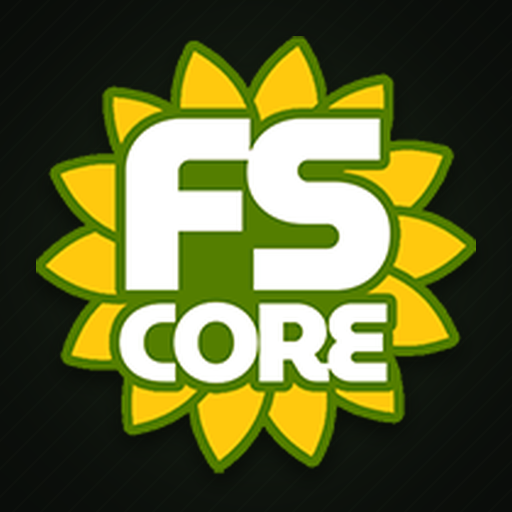

  

<h1 align="center">FSCore - Rural Life Simulation Framework</h1>

  <strong>One mod that turns a Farming Simulator 25 save into a living town.</strong> 
  For a single player, a server with friends, or a dedicated community server.

  <a href="https://fscore.gg/"><strong>fscore.gg</strong></a> ·
  <a href="https://discord.gg/xd9B6uSEjV">Discord</a> ·
  <a href="https://www.youtube.com/@FSCoreFramework">YouTube</a> ·
  <a href="https://www.facebook.com/fscoremod">Facebook</a> ·
  <a href="https://github.com/RocklandUSA/FS25_FSCore/issues">Issues</a> ·
  <a href="https://github.com/RocklandUSA/FS25_FSCore/discussions">Discussions</a>

---

**Status:** FSCore **1.0.0.0** goes to GIANTS for ModHub review in November 2026. It is the first public release; once GIANTS approves it, it is downloaded from the official ModHub like any other mod. This repository holds the documentation and the public issue tracker. It does not contain the mod itself.

## Choose your path

| Audience | What you will find |
|---|---|
| **[I'm a Player](docs/for-players/)** | What FSCore adds, your first session, the phone and its apps, homes, jobs, the keys to know |
| **[I'm a Server Admin](docs/for-admins/)** | Install, first start, map setup and community projects, every setting, every console command, troubleshooting |
| **[I'm a Modder](docs/for-modders/)** | How other mods can talk to FSCore through its public API |

## Quick facts

- **Game:** Farming Simulator 25 on PC or Mac, with the latest game update (1.25.1 or newer)
- **Version:** 1.0.0.0 (see the [changelog](CHANGELOG.md))
- **Author:** RocklandUSA Gaming
- **Modes:** singleplayer, player-hosted multiplayer and dedicated servers
- **Languages:** English, German, Polish and French (FSCore follows the game's language)
- **Setup:** none to start playing. On the base-game maps the town is ready on the first load; no console command is ever required
- **Modules:** 50 module switches on the FSCore Settings page. Want only fishing and dogs? Turn the rest off

## What FSCore adds

Your farm is only the beginning. In FSCore you are a person in a living town.

- **A phone with 44 apps** (`/` key): Messages, Contacts, FarmSnap photos, Village Chat, Weather, Calendar, Finances, Navigation with turn-by-turn directions, your ID and licences, keys, backpack, recipes, your dog, jobs, reputation and the town's news. For the farm: PlotView (every field, what it needs next, where the harvest sells best), HerdSync (every barn), SimpliBarn barn cameras, SiloView, Productions and Farm Stats.
- **Character and identity:** a character with a name, date of birth and specialisation, an ID card and the **My ID** screen with your licences, skill levels and overall FSCore level.
- **Money that matters:** pocket cash and ATMs, current, savings and business accounts, invoices between players and farms, income tax, VAT and property tax, a credit rating, mortgages and dealership finance, with every loan's details in the Finances app.
- **Homes:** Lizard Realty sells the map's houses outright or with a mortgage. Furnish every room from almost 300 pieces of furniture, landscape the garden, sit in chairs, sofas and recliners, and give spare keys to the people you trust.
- **Build it yourself:** buy a building lot and the plans, set the site out, bring the pallets and build stage by stage with hammer, drill, trowel and paint roller: the Ranch House and the Harvest House, garden sheds, greenhouses, pergolas, chicken coops, wood stores, compost bins and raised beds that grow crops through the seasons.
- **A town that grows:** AutoPlot turns a Town Hall field into a new neighbourhood with streets, street lights, lawns and lots for sale. Every road gets a street name and every home an address.
- **Community projects that unlock features:** the whole server builds the town's big buildings together, and each one opens a feature when it is finished (see below).
- **Shiftit company jobs:** mail and parcel rounds, propane deliveries, towing calls, kerbside refuse collection, warehouse forklift shifts and Lizard Lawncare mowing contracts, in company vehicles and work clothes, with ranks that pay up to 35 % more.
- **Gigs and a real wage:** Giggit gigs (deliveries, pallet freight, towing, junk cleanup, power washing), Farm Eats bakery and pizza deliveries, and hourly pay at your farm's time clock with roles, permissions and payroll.
- **Nine skill trees:** Agronomy, Husbandry, Forestry, Logistics, Mechanical, Business, Community, Angling and Mining, ten levels each with titles, leaderboards and an overall level shown on name tags.
- **Farming ranks:** the farm work you do by hand or with helpers earns Farm Points, 15 farming ranks, medals and a Farmer of the Week.
- **The mine:** ride the lift down, follow the ore veins with pickaxe and rock drill, lay track for the ore carts, find fossils, geodes and diamonds, smelt ingots at the mine forge and craft jewellery and building materials.
- **Survive and thrive:** hunger, thirst and fatigue, food that goes stale, farm fridges, storage lockers and crates, a backpack (`F10` or `Alt` + `I`), crafting, shops and fuel stations with hand-nozzle refuelling, and a radial menu (`F9`) for emotes, quick actions and dog commands.
- **Your own wheels:** dealership with finance, vehicle keys and locks, a personal garage, farm garages, vehicle rentals, a mechanic, and equipment licences (Ag Operator, Truck, Forestry) when the server switches them on.
- **The great outdoors:** fishing with weather-aware bait and nine species, marina boards and tournaments, rentable boats and rafts, farm dogs adopted from the Pet Shelter, scavenging and salvaging, and the EGG RUN arcade cabinet with daily and all-time high scores.
- **Seasons and decoration:** Seasonal Street Lights for Christmas, New Year, Lunar New Year, Carnival, Halloween, the harvest and more, plus Map Essentials (vending machines, bins and decorations) on any map.

## Community projects

The town's big buildings are built by the whole server, and each one **unlocks** something when it is finished. Town Hall pays for the materials and the work shifts, every pallet is tracked to its site, and the top builders earn bronze, silver and gold hammer trophies.

| Community project | What it unlocks when the community has built it |
|---|---|
| **Car Dealership** | FSCore's dealership for player-owned vehicles (buying, test drives, customising and repairs at the mechanic) and the Shiftit towing calls |
| **Post Office & Parcel Depot** | The Shiftit mail and parcel rounds |
| **Self-Storage Yard** | Big storage units to rent, for everyone |
| **Co-op Grain Elevator** | The Farmers Co-op: crops sell there for 10 % more than the best price on the map, plus massive grain storage |

An administrator sets each project out from the Admin Hub and can override any unlock with `fscUnlock`. The game's own shop and workshop for farm machinery are never locked. Details: [Community projects and map setup](docs/for-admins/COMMUNITY_PROJECTS.md).

## Ready on every base-game map

Riverbend Springs, Zielonka, Hutan Pantai, Kinlaig and Catuaí come set up: farms, welcome boards, time clocks, garages, shops, NPCs and fuel stations. Start a new save and the town is already alive. On other maps an administrator places the features with the Admin Hub and checks the result in **Map Audit**.

## Built for server owners

- The **Admin Hub** (`F6`) opens every admin tool: Map Audit, Community Projects, Real Estate, moderation, the placement editors and more. Players get the **Player Hub** on the same key.
- The **FSCore Settings** page (pause menu, FSCore tab) has 93 live settings, among them a switch for every module. See the [settings reference](docs/for-admins/SETTINGS.md).
- Works in singleplayer and on dedicated servers. All money, items and records are decided on the server.
- FSCore does not monitor or track anyone. Every server owner sets their own rules.

## Keys to know

| Key | What it does |
|---|---|
| `/` (also numpad `/`) | Open or close the phone |
| `Left Alt` + `/` | End phone navigation (cancel the route and put the mounted phone away) |
| `F10` or `Left Alt` + `I` | Open the backpack |
| `R` | Interact with kiosks, boards, ATMs, doors, seats and items |
| `F9` | Radial menu |
| `F6` | Admin Hub for administrators, Player Hub for everyone else |
| `Left Ctrl` + `H` | Show or hide the money display |

All bindings can be changed in the game's control settings. More in the [player guide](docs/for-players/#keys-to-know).

## Installation

1. When FSCore is live on the ModHub: open the in-game ModHub, search for **FSCore** and download it, or download the zip from the ModHub website and put it (do not extract it) in your mods folder:
   - Windows: `Documents\My Games\FarmingSimulator2025\mods\`
   - Mac: `~/Library/Application Support/FarmingSimulator2025/mods/`
2. Enable the mod when you create or load a save.
3. For dedicated servers see the [server installation guide](docs/for-admins/INSTALL.md).

## Planned for 1.1 (not in 1.0.0.0)

These are ideas for the next update, aiming for about two weeks after the 1.0.0.0 submission. They are **planned, not promised**, and none of them is in 1.0.0.0. Tell us on [Discord](https://discord.gg/xd9B6uSEjV) what you would play first.

- **Community and town:** the Fire Station and Public Works as community projects with their own jobs; a new package of community projects; a more detailed Co-op Grain Elevator; more detailed tower-crane operation with loads arriving by truck
- **New Shiftit jobs:** utility bucket truck, storm clean-up, old barn demolition, heavy haul, forestry jobs, crop dusting by helicopter with a new licence
- **Homes:** backyard swimming pool and pool furniture, a backyard horse stable
- **Farming and land:** buying farmland through Real Estate, neighbours working the unsold fields, precision farming support
- **Fun:** swimming underwater, fish record trophies per species
- **Under the hood:** a smaller download, a smoother server start-up, map layouts for popular community maps

Bugs from 1.0.0.0 are fixed first.

## License

FSCore is closed source and is distributed only through the official GIANTS ModHub. See [LICENSE](LICENSE) for the terms. Other mods may integrate with FSCore through its public API; see the [modder notes](docs/for-modders/).

## Community and support

- **Website:** [fscore.gg](https://fscore.gg/)
- **Discord:** [discord.gg/xd9B6uSEjV](https://discord.gg/xd9B6uSEjV)
- **YouTube:** [@FSCoreFramework](https://www.youtube.com/@FSCoreFramework)
- **Facebook:** [fscoremod](https://www.facebook.com/fscoremod)
- **Bugs and feature requests:** the [Issues tab](https://github.com/RocklandUSA/FS25_FSCore/issues). Please read [CONTRIBUTING.md](CONTRIBUTING.md) first.
- **Questions:** the [Discussions tab](https://github.com/RocklandUSA/FS25_FSCore/discussions)

Many thanks to our community for every bug report, every idea and every late night on the server.
