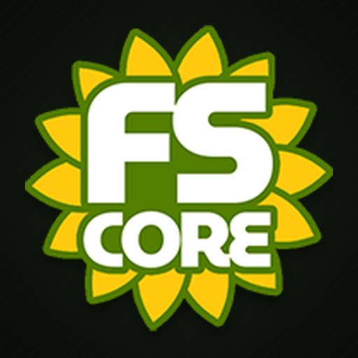

  

<h1 align="center">FSCore - Rural Life Simulation Framework</h1>

  <strong>One mod that turns a Farming Simulator 25 save into a rural life simulation.</strong> 
  For a single player, a server with friends, or a dedicated community server.

  <a href="https://fscore.gg/"><strong>fscore.gg</strong></a> ·
  <a href="https://github.com/RocklandUSA/FS25_FSCore/issues">Issues</a> ·
  <a href="https://github.com/RocklandUSA/FS25_FSCore/discussions">Discussions</a>

---

**Status:** submitted to the GIANTS ModHub and in review. FSCore is distributed only through the official ModHub. This repository holds the documentation and the public issue tracker; it does not contain the mod itself.

## Choose your path

|  | Audience | What you'll find |
|---|---|---|
| 🎮 | **[I'm a Player](docs/for-players/)** | What FSCore adds, what you'll see in your first session, the phone, the keys to know |
| 🛠️ | **[I'm a Server Admin](docs/for-admins/)** | Install, first start, the Settings page, every server rule, every console command, troubleshooting |
| 💻 | **[I'm a Modder](docs/for-modders/)** | How other mods can talk to FSCore through its public API |

## Quick facts

- **Game:** Farming Simulator 25, version 1.24 or newer (PC)
- **Author:** RocklandUSA Gaming
- **Modes:** singleplayer, multiplayer, dedicated servers
- **Setup:** none. FSCore configures itself on the first load. No console command is required to play.
- **Modules:** every feature module can be switched off on the FSCore Settings page

## What is included

Everything is in this one mod.

- **Character identity:** a profile with name, date of birth and specialization, an ID card and licenses
- **Personal money:** a cash wallet and personal bank accounts (checking, savings, business) next to the normal farm account, with ATMs, a banking menu, loans, credit score, invoices, taxes and payroll
- **Work:** time-clock kiosks with hourly pay, mini jobs (bakery and pizza deliveries, junk cleanup) and a bulletin board for player postings
- **Farm management:** member roles, permissions and block lists; eight preset farms with names, colors and starting balances that are set up automatically on first load
- **Needs:** hunger and thirst with food from the inventory backpack, weight limits, carryable crates, coolers and lockers, and crafting stations
- **Vehicles:** vehicle keys and access control, a dealership with financing, a personal garage, a farm garage for storing and spawning machines, and vehicle rentals
- **Fishing and boating:** rods, bait that reacts to weather and water, nine fish species, a fishing license, fish buyers, marina boards with live conditions and tournaments, rentable boats with anchors and on-deck coolers
- **Farm dogs** with needs, beds and bowls, follow and patrol behavior and a farm-duty bonus for animal pens
- **Scavenging and salvaging:** search bins and spots for collectibles and antiques and sell them to buyers
- **Clothing store and wardrobe**, reputation with seven skill trees and leaderboards, welcome signs, teleporting building doors, a zone editor, an arrivals screen for new players, and a compass with heading lock, ground bearing line and per-player settings that the jobs and deliveries use for directions
- **A phone** with apps for messages, contacts, finance, jobs, the farm, fishing, notes, stats and a first-day Journey checklist for new players
- **A server rule engine** with more than thirty rules (hide nametags, block map teleport, manual attach, no AI workers, lock production output, disable loans, and many more). Every rule is toggled live from the FSCore Settings page and saved with the game

## Modules can be turned off

The FSCore Settings page lists every feature module: Fishing, Boating, Pets, Scavenger, Salvaging, Clothing, Dealership, Garage, Farm Garage and Vehicle Rentals. Switch a module off and it stays dormant on the next load without touching anything else.

## First start

Put the zip in your mods folder and start a game. On the first load FSCore configures the existing farms with the preset names, colors and starting balances. Nothing has to be typed into a console. The server name and the house rules shown on the identity screen can be changed at any time by an administrator in the Admin Hub (F6) or with the console commands `fscSetServerTitle` and `fscSetServerRules`.

FSCore does not monitor or track anyone. Every server owner decides their own rules.

## Keys to know

| Key | What it does |
|---|---|
| `/` (also numpad `/`) | Open or close the phone |
| `F10` or `Alt` + `I` | Open the inventory backpack |
| `R` | Interact with kiosks, boards, ATMs, doors and items |
| `F9` | Radial menu |
| `F6` | Admin Hub (administrators only) |
| `Ctrl` + `B` | Banking menu |
| `Ctrl` + `H` | Toggle the money display |
| `Delete` | Toggle the economy HUD |

All bindings can be changed in the game's input settings.

## Installation

1. In Farming Simulator 25 open the Mod Hub, search for **FSCore** and subscribe, or download the zip from the ModHub website and place it (do not extract it) in `Documents\My Games\FarmingSimulator2025\mods\`.
2. Enable the mod in the mod menu and load your save.
3. For dedicated servers see the [Server Installation guide](docs/for-admins/INSTALL.md).

## License

FSCore is closed source and is distributed only through the official GIANTS ModHub. See [LICENSE](LICENSE) for the terms. Other mods may integrate with FSCore through its public API; see the [modder notes](docs/for-modders/).

## Community and support

- **Website:** [fscore.gg](https://fscore.gg/)
- **Bugs and feature requests:** the [Issues tab](https://github.com/RocklandUSA/FS25_FSCore/issues). Please read [CONTRIBUTING.md](CONTRIBUTING.md) first.
- **Questions:** the [Discussions tab](https://github.com/RocklandUSA/FS25_FSCore/discussions)

Many thanks to our community for reporting bugs, giving us feedback and great ideas.
